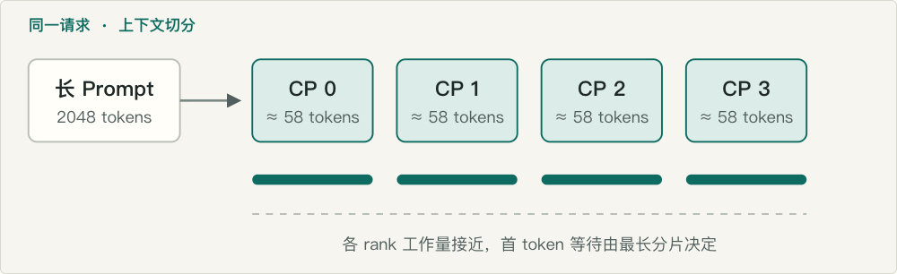
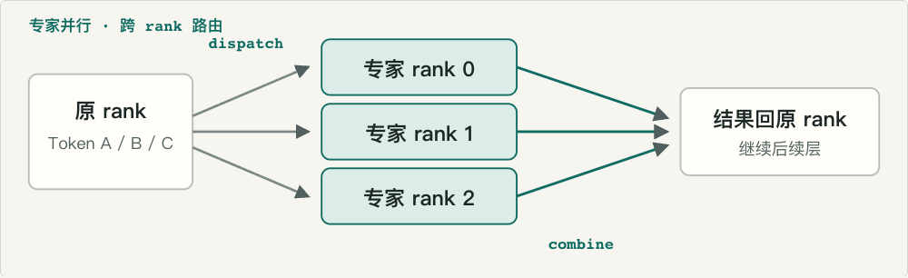
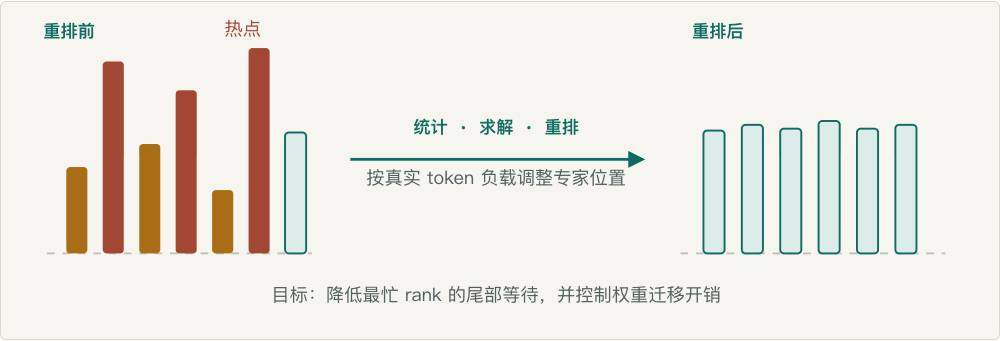
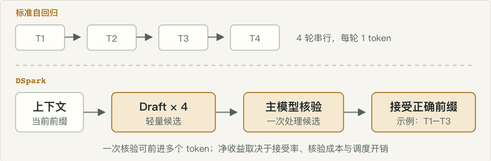
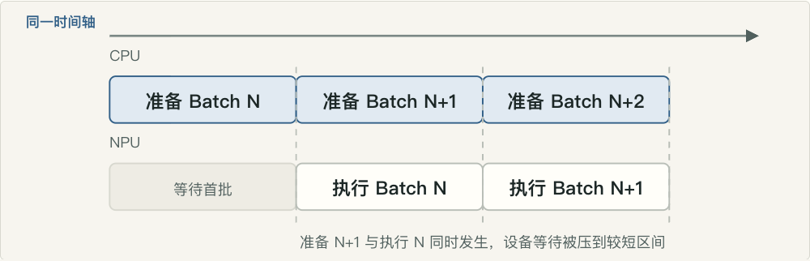
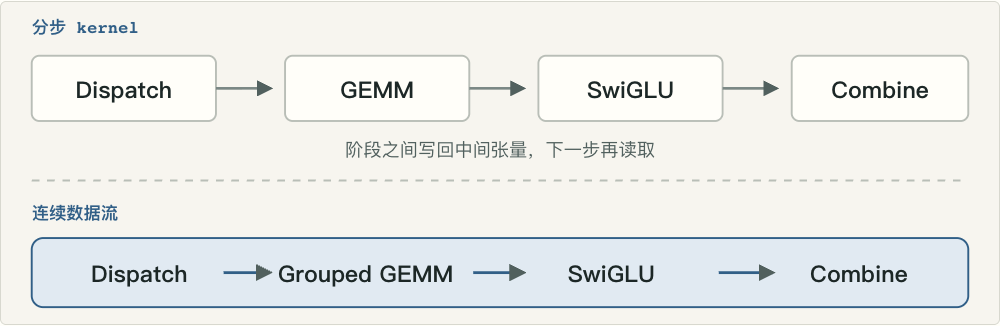
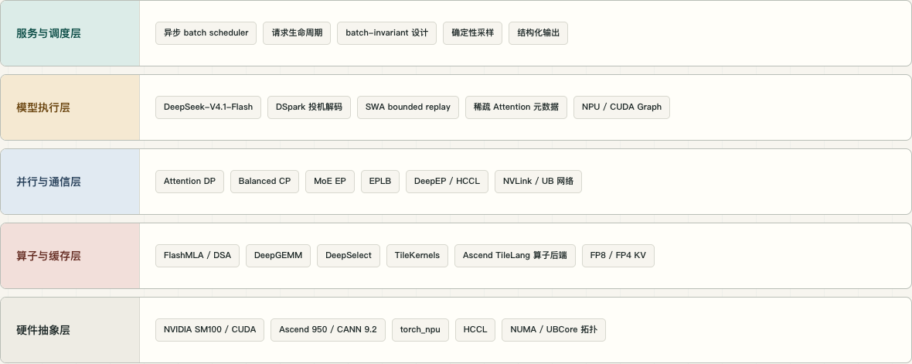
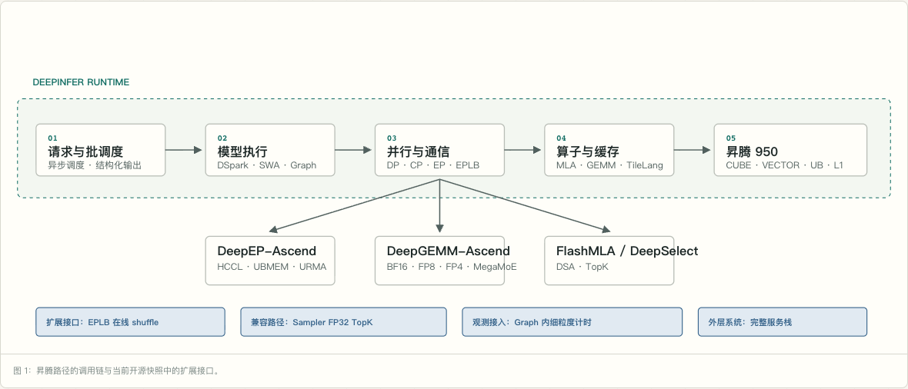
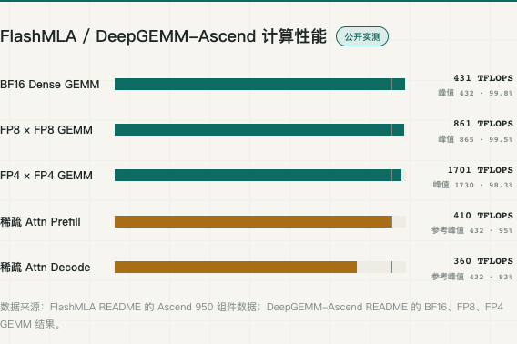
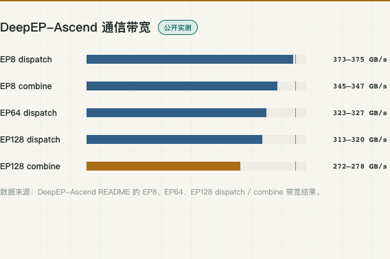

> 完整交互版：https://besproma.github.io/deepinfer-ascend-analysis/
>
> 代码快照：`774ce24`  
> 分析日期：2026-10-21  
> 分析范围：并行调度、模型级优化、昇腾适配、芯片内数据流、源码证据与公开性能数据

DeepInfer 是 DeepSeek 面向 DeepSeek-V4.1-Flash 深度定制的高性能推理框架。它与通用推理框架的主要差别，不是又增加了一套模型接入接口，而是把模型结构、稀疏 Attention、MoE 路由、KV 规则和服务调度放在同一个设计闭环中，并分别实现 NVIDIA 与昇腾后端。

本文重点回答三个问题：DeepInfer 为什么要做这些优化，昇腾适配到底落在哪些工程层，以及公开性能数据能够说明什么。

## 一、为什么要重新组织推理路径

一次大模型请求看似只是“输入 Prompt、输出 Token”，实际会经过一条很长的关键路径：

1. Prefill 阶段处理整段 Prompt，并产生首 Token。
2. MoE 层根据路由把 Token 分发到不同专家，再汇合结果。
3. Decode 阶段逐个 Token 自回归生成。
4. 历史上下文在 KV Cache 中复用；缓存未命中时还要恢复。
5. CPU 侧持续完成请求检查、批处理拼装和元数据准备。

这条链路的耗时，往往不只来自矩阵计算。长 Prompt 可能只落在一组设备上；MoE 的热点专家可能让最忙 rank 决定整轮时间；Decode 每一步都很小，却要重复读取权重和启动 kernel；CPU 排批、集合通信和中间张量写回还会制造额外等待。

DeepInfer 的核心思路，是让模型已经知道的形状与规则进入执行系统，提前消除这些等待。

| 关键路径 | 常见问题 | DeepInfer 对应机制 | 目标 |
| --- | --- | --- | --- |
| 长上下文 Prefill | 单条请求难以拆到更多设备 | Balanced CP | 缩短首 Token 关键路径 |
| MoE 专家路由 | 热点专家与跨 rank 分发形成等待 | EP、DeepEP、EPLB | 扩大专家池并压低通信与尾部负载 |
| 逐 Token Decode | 串行步数多，小 batch 算力利用率低 | DSpark | 一次验证多个候选 Token |
| KV 缓存恢复 | 已失效历史仍被完整重放 | SWA bounded replay | 只处理当前输出需要的最短后缀 |
| CPU / NPU 协同 | 设备执行期间 CPU 在准备下一批 | 异步批调度 | 让排批与设备执行重叠 |
| MoE 数据路径 | 多个 kernel 反复写回和读取中间结果 | MegaMoE | 把分发、GEMM、SwiGLU、汇合接成连续数据流 |

这些机制并非每一项都由 DeepInfer 首次提出。它的差异化在于围绕一个固定模型，把并行方式、通信布局、缓存语义与硬件数据流一起调整。

## 二、七项关键技术如何减少等待

### 1. Balanced CP：让一条长请求也能多卡并行

传统的数据并行主要增加同时处理的请求数量，却不会自动拆开单条长 Prompt。当一条请求的上下文很长时，它仍然可能由一组设备独自承担；某个 rank 分到更多 Token，其他 rank 就要等待，形成木桶效应。

Balanced CP 按上下文切分一条请求，并尽量平衡各 rank 的 Token 数和计算量。它扩大单请求可用的计算资源，同时缩小不同 rank 的完成时间差，因此优化的是首 Token 阶段的尾延迟。

昇腾离线 CI 使用 2 节点 × 8 NPU、EP16 / CP8 的并行配置，覆盖了这一组合路径。该配置用于功能验证，不是生产规模的性能结论。

### 2. MoE EP 与 DeepEP：把专家容量扩到集群

MoE 模型包含大量专家。专家并行把不同专家分布到不同 rank，从而扩大可容纳的权重和可用算力。但 Token 必须先通过 dispatch 送到目标专家，计算后再通过 combine 返回原 rank；通信路径处理不好，新增算力会被跨卡等待抵消。

DeepEP-Ascend 负责昇腾上的分发与汇合，并接入 HCCL、HCOMM、UBMEM 和 URMA 等通信能力。它的价值来自两件事同时成立：专家计算扩展到更多设备，跨设备通信成本得到控制。

公开验证覆盖 EP128。这里的 EP128 表示 128 个专家并行 rank，不是 128 个专家。公开数据中，dispatch 峰值约为 313–320 GB/s。

### 3. EPLB：让专家布局跟随真实热点

专家铺到更多设备之后，总量通常不再是主要矛盾，局部热点才是。某些专家承接的 Token 明显更多，对应 rank 就会成为新的长尾。

EPLB 先观察真实 Token 的负载，再计算新的专家布局，并通过重排压缩最忙 rank 的排队时间。当前实现已经覆盖负载统计、方案求解和周期重排；在线权重迁移保留平台对称内存接口，便于继续利用昇腾的统一总线能力。

### 4. DSpark：把一步一 Token 改成一次核验多个

标准自回归 Decode 每轮只前进一个 Token。生成序列较长时，串行轮次很多；小 batch 下设备算力难以铺满，但每轮仍要承担权重读取、kernel 启动和调度成本。

DSpark 先生成多个轻量候选 Token，再由主模型一次核验。主模型接受正确前缀后，一次迭代可以前进多个 Token。实际收益取决于候选接受率、核验成本和额外调度开销。

昇腾算子目录中已经包含 DFlash、采样和相关调度路径，说明该机制已进入硬件后端实现，而不只停留在模型语义层。

### 5. SWA bounded replay：不要重算已经失效的历史

滑动窗口注意力只关注最近的上下文窗口。缓存恢复时，如果仍按通用路径完整重放历史，窗口之外的 Token 虽然已经不影响当前输出，却还会消耗 KV 读取、数据搬运和 Prefill 计算。

SWA bounded replay 只重放覆盖当前注意窗口和最大回溯长度的必要后缀。V4.1 默认保留 140 个 Token，具体收益取决于窗口配置、缓存复用率和命中率。

### 6. 异步批调度：下一批在上一批执行时准备好

如果 CPU 和 NPU 严格轮流工作，每一轮都要先完成请求检查、batch 拼装和元数据准备，再交给设备执行。Decode 单批执行时间较短时，这部分 CPU 等待会占据明显比例。

异步调度让 CPU 在 NPU 执行当前 batch 时准备下一批。理想情况下，一轮耗时更接近“CPU 准备时间”和“NPU 执行时间”中较长的一项，而不是两者相加。NPU Graph 还能通过捕获与 replay 降低 kernel 启动开销。

### 7. MegaMoE：把多次 kernel 往返接成一条数据流

dispatch、grouped GEMM、SwiGLU 和 combine 如果分别作为独立 kernel 执行，每一步都要把中间结果写回，再由下一步读取。这会增加访存、缓冲区占用、kernel 启动和同步点。

MegaMoE 让通信布局、专家矩阵形状和中间结果传递彼此匹配，减少中间张量的往返，并创造通信与计算重叠的机会。它优化的是整条 MoE 数据路径，而不是单个 GEMM 的峰值。

## 三、DeepInfer 与 vLLM、SGLang 的关系

DeepInfer 最初主要基于 vLLM 构建，同时吸收了 SGLang、TensorRT-LLM 等框架的设计思路。它并非从零重写所有通用能力，也不是替代所有推理框架。

与 vLLM、SGLang 的主要差异可以概括为：通用框架优先覆盖更多模型、硬件和接口；DeepInfer 则只围绕 DeepSeek-V4.1-Flash 做单模型垂直优化。固定模型带来了更强的协同设计空间：

- 算子可以围绕固定 head 形状、稀疏模式和精度格式做极致调优。
- 通信可以理解 MoE 路由和 GEMM 时序，而不只提供通用 all-to-all。
- 调度可以把 Draft Token、SWA 重放、缓存布局和 NPU Graph 一起考虑。
- 昇腾后端可以针对 CUBE、VECTOR、L1、UB 和 FixPipe 重新组织数据流。

代价同样明确：模型泛化能力较弱，版本耦合更强，每代硬件都需要维护独立实现。

| 设计维度 | 通用推理框架常见策略 | DeepInfer 策略 | 技术含义 |
| --- | --- | --- | --- |
| 模型范围 | 多模型、多模态、广泛兼容 | 当前聚焦 DeepSeek-V4.1-Flash | 可以做模型级协同，跨模型复用需重新适配 |
| Attention | 通用 PagedAttention / FlashAttention | DSA 稀疏索引、FP8 / FP4 KV、固定 head 形状 | 稀疏场景优化空间更大，非目标模型不适用 |
| MoE 通信 | 通用 all-to-all 与集合通信 | DeepEP 与 MegaMoE | 面向专家 GEMM 的通信和计算协同 |
| 执行调度 | 通用连续批处理 | 异步调度、DSpark、SWA 有界重放 | 针对生成负载减少空泡与重复计算 |
| 硬件后端 | 统一抽象、渐进优化 | NVIDIA 与昇腾分别维护算子、布局与通信 | 硬件利用率更高，维护矩阵更大 |

因此，比较 DeepInfer、vLLM 和 SGLang 时，不能只看 API 或模型数量。更合适的观察对象是：目标模型、目标硬件和真实请求分布下的端到端 Pareto 前沿。

## 四、昇腾适配不是简单兼容层

DeepInfer 的昇腾路径在构建、运行时、拓扑、通信、算子和图执行六个层面都有独立实现。

1. **构建层**：通过 `DEEPINFER_ACCELERATOR=ascend` 选择昇腾依赖与 `NpuExtension`，并加入 `asc_utils.cpp`、`graph_timer_asc.cpp` 等独立源码。
2. **运行时层**：使用 `torch_npu` 映射大量 CUDA 风格调用，固定 TileLang 的 `ascend` 目标，配置 HCCL 缓冲、超时和可扩展显存，并固定主机内存。
3. **拓扑层**：通过 `/dev/davinci*`、`/sys/class/ubcore` 和 `npu-smi` 发现 NPU、UB 实体与 NUMA 关系。
4. **通信层**：分布式后端使用 HCCL；DeepEP-Ascend 使用 HCCL / HCOMM、UBMEM、URMA 与 DeepJIT 完成 EP dispatch / combine。
5. **算子层**：Ascend TileLang 覆盖 KV、采样、DFlash、SWA、CP、视觉与结构化输出。FP8 scale 在昇腾上使用 `int16` 打包，与 NVIDIA 的 `int32` 路径区分。
6. **图执行与测试层**：NPU Graph 支持捕获和 replay；离线推理 CI 覆盖 2 节点 × 8 NPU。

开源快照中，各层已经形成清晰实现路径：

- EPLB 的负载统计和重排计算已具备，在线权重迁移可沿平台对称内存接口继续扩展。
- DeepSelect 已覆盖 BF16 TopK；FP32 且需要返回 value 时，由 `torch.topk` 保持功能兼容。
- NPU Graph Timer 已定义统一接口，细粒度平台事件可按目标 CANN 工具链接入。
- FlashMLA 的昇腾实现聚焦 V4.1 稀疏 Attention 的 Prefill 与 Decode。
- 完整 KV Cache 服务、P/D 编排和跨 DP 副本负载均衡属于外层服务系统；开源引擎保留缓存初始化、保存钩子与 P/D 接入点。

### deepseek-recipe 的作用

`deepseek-recipe` 是 API 协议适配与 Prompt / Token 编解码组件，负责 Chat Completions、Responses、Messages 转换、Prompt 渲染、Tokenizer 编解码、流式解析与工具调用。

它不是推理引擎，也不是 KV Cache、P/D 编排或副本负载均衡的补齐件。调用方仍需提供模型推理、工具执行与 HTTP 传输。因此，DeepInfer 与 deepseek-recipe 是推理核心和表示层适配的关系，而不是同一层能力的替代关系。

## 五、昇腾 950 上的计算流与微架构优化

DeepInfer 的昇腾实现不是把 CUDA kernel 逐行翻译成 NPU 代码，而是围绕昇腾 AI Core 的异构执行资源重新安排数据流。重点资源包括：

- **CUBE**：矩阵计算。
- **VECTOR**：向量计算、反量化、softmax 与结果整理。
- **MTE2 / MTE3**：全局内存、L1 与片上缓冲之间的数据搬运。
- **FixPipe**：矩阵累加结果的搬出与格式处理。
- **UB**：统一向量缓冲，承担向量计算与中间结果整理。
- **L1 / L0C**：矩阵输入缓存与累加结果存储。

优化覆盖 Ascend 950 的 `dav-3510` 共用核心架构。应用到 950PR 与 950DT 时，算子能力和通信带宽会因具体型号、HDK、固件和组网配置而不同。

### Prefill：计算受限，目标是保持 CUBE 持续工作

Prefill 一次处理较多 query Token，矩阵计算量足够大。FlashMLA 昇腾实现为每个 AI Core 分配 64 个 query head，采用 1 CUBE + 2 VECTOR 的核内编组，把 softmax、反量化、ND→NZ 和 FixPipe 搬运分摊到两个 VECTOR Core。

流水使用“当前块 QK、上一块 PV、后续块预取”的交错方式，使 CUBE 不必等待 softmax。skip-scale 只在 online softmax 的最大值偏移超过阈值时执行重缩放，减少 FixPipe 和向量计算。

### Decode：数据与搬运更敏感

Decode 每步 query Token 少、KV 历史长，更容易受 KV 读取、FP8 / FP4 反量化、索引 gather 和 FixPipe 影响。公开数据中，Decode 为 360 TFLOPS，利用率约 83%，低于 Prefill 的 95%，这一差异与 Decode 的结构性特征一致。

因此实现将 KV 的 data 与 scale 按 Token 相邻存储，减少 MTE2 请求；使用 gather2 合并两个 Token 的搬运；并在 UB 中完成 ND 到 NZ 的高吞吐转换。

### 八项关键微架构优化

| 优化 | 原有问题 | 实现方式 | 作用 |
| --- | --- | --- | --- |
| ND → NZ 片上转换 | 稀疏 KV 无法在 GM → L1 时顺路完成布局转换 | 先进入 UB，再由 SIMD VF 转换 | 避免 L2 访存合并失效 |
| Token 交错 KV 布局 | data 与 scale 分离会增加搬运请求 | 同一 Token 的 data / scale 相邻存放 | 降低 Decode 的 MTE2 请求数和地址开销 |
| 双 L1 bank 均衡 | 单 bank 带宽可能限制矩阵供数 | 将 Q、K、V 等张量分布到两个 L1 bank | 让 CUBE 输入供给更稳定 |
| 昇腾专用 scale 布局 | GPU 与 NPU 的 scale ABI 不同 | FP8 scale 使用 `int16` 成对打包并按 MN-major 存放 | 匹配昇腾硬件访问效率 |
| Skip-scale 与跨核同步 | 每块都重缩放会增加 FixPipe 与向量运算 | SS buffer 与 cross-core flag 传递是否重缩放 | 减少不必要的 UB 和 VECTOR 工作 |
| gather2 合并搬运 | 大量细小 gather 请求会阻塞 MTE2 | 一次请求搬运两个稀疏 Token | 降低 issue queue 压力 |
| 指令缓存控制 | 过度展开会让小容量 icache 频繁换入换出 | 硬件循环、谨慎展开与函数内联 | 保持 CUBE / VECTOR / SIMD VF 流水稳定 |
| FixPipe 感知流水 | 输出 rescale 可能占用 L0C 并引入额外矩阵乘 | accumulator 放 UB，按块执行 FixPipe 搬出与 VECTOR 累加 | 减少 L0C 占用和额外计算 |

这些优化的共同目标，是减少 CUBE 等待供数、等待 softmax、等待搬运和等待同步的时间。矩阵乘峰值只代表理想条件下的计算能力，真实效率取决于整条数据流能否持续供数。

## 六、公开性能数据与来源

公开性能数据来自 DeepInfer README 及其随仓库组件文档。下面分别列出计算吞吐和通信带宽，不将组件实测直接等同于完整服务的端到端吞吐。

### FlashMLA 与 DeepGEMM-Ascend

| 项目 | 实测结果 | 参考峰值 | 利用率 |
| --- | ---: | ---: | ---: |
| BF16 Dense GEMM | 431 TFLOPS | 432 TFLOPS | 99.8% |
| FP8 × FP8 GEMM | 861 TFLOPS | 865 TFLOPS | 99.5% |
| FP4 × FP4 GEMM | 1701 TFLOPS | 1730 TFLOPS | 98.3% |
| 稀疏 Attention Prefill | 410 TFLOPS | 432 TFLOPS | 约 95% |
| 稀疏 Attention Decode | 360 TFLOPS | 432 TFLOPS | 约 83% |

这里的 Prefill 数据应读作：实测 410 TFLOPS，BF16 参考峰值为 432 TFLOPS，前者约为后者的 95%。`410` 和 `432` 是两个独立的 TFLOPS 数值，`410 / 432` 不作为比值写法使用。

### DeepEP-Ascend 通信带宽

| 配置 | dispatch | combine |
| --- | ---: | ---: |
| EP8 | 373–375 GB/s | 345–347 GB/s |
| EP64 | 323–327 GB/s | 未列出 |
| EP128 | 313–320 GB/s | 272–278 GB/s |

DeepEP-Ascend 的公开带宽数据对应 950DT、验证版 HDK 与外部 Clos 网络。不同 HDK、固件和网络拓扑下应重新测量，不能直接外推为任意生产集群的带宽。

### 数据来源

- [DeepInfer README](https://github.com/deepseek-ai/DeepInfer/blob/774ce244b87cc0eb8d4b94ab9f5de2ab22049f01/README.md)
- [FlashMLA README](https://github.com/deepseek-ai/FlashMLA)
- [FlashMLA 昇腾 Prefill 技术说明](https://github.com/deepseek-ai/FlashMLA/blob/main/docs/20260930-ascend-prefill-deep-dive-zh.md)
- [DeepGEMM-Ascend README](https://github.com/deepseek-ai/DeepGEMM-Ascend)
- [DeepEP-Ascend README](https://github.com/deepseek-ai/DeepEP-Ascend)
- [deepseek-recipe README](https://github.com/deepseek-ai/deepseek-recipe/blob/935817c66f5d6e64838f419692545f06787e485f/README.zh.md)

## 七、主要源码证据

| 源码 | 关键内容 |
| --- | --- |
| `README.md` | 说明 DeepInfer 支撑大规模生产服务；开源版本聚焦离线推理与规模化服务核心能力 |
| `deepinfer/engine/llm_engine.py` | 缓存初始化、P/D 初始化、KV 保存与预填充钩子 |
| `deepinfer/platform.py` | HCCL、TileLang `asc` 后端、torch_npu 映射、ACL 主机内存固定与 FP8 scale 类型 |
| `deep_cluster/hardware/ascend.py` | davinci 设备、ubcore sysfs 与 npu-smi 拓扑发现 |
| `setup.py` / `build.sh` | `NpuExtension`、昇腾专用 C++ 源码与构建选择 |
| `deepinfer/model_executor/eplb/__init__.py` | EPLB 负载统计、周期重排与平台 shuffle 扩展点 |
| `deepinfer/npu_ops/deep_select.py` | BF16 TopK 与 FP32 兼容路径 |
| `csrc/graph_timer/graph_timer_asc.cpp` | NPU Graph Timer 统一接口 |
| `tests/models/test_offline_inference.py` | 昇腾离线推理 CI 的 EP16 / CP8 配置 |
| `deepinfer/model_executor/layers/tilelang_ops/asc/` | KV、采样、DFlash、SWA、CP、视觉与结构化输出算子 |

## 八、核心结论

DeepInfer 的技术价值，不在于重新发明每一个并行名词，而在于把模型结构、算子、通信、缓存语义和调度系统放进同一个优化闭环。

对昇腾而言，它已经形成从构建、运行时、拓扑、集合通信、TileLang 算子到 NPU Graph 的多层后端；对 DeepSeek-V4.1-Flash 而言，它利用固定模型带来的确定性，减少长 Prompt、MoE 热点、逐 Token Decode、缓存重放和数据搬运形成的等待。

公开数据表明，FlashMLA、DeepGEMM-Ascend 和 DeepEP-Ascend 在目标配置下已经达到较高组件效率。下一步评价应聚焦目标模型、目标 HDK 和真实请求分布下的完整服务链路，包括首 Token 延迟、每 Token 输出时间、吞吐、缓存命中与服务稳定性。

---

**术语速查**

- **DSA**：DeepSeek Sparse Attention，按索引只关注部分 KV Token。
- **EP**：Expert Parallel，将 MoE 专家分布到不同 rank。
- **EPLB**：Expert Parallel Load Balancing，根据负载重排专家。
- **CP**：Context Parallel，将长上下文切分到不同 rank。
- **P/D 分离**：Prefill 与 Decode 分别部署和调度。
- **HCCL / HCOMM**：昇腾集合通信与底层通信组件。
- **URMA / UBMEM**：DeepEP-Ascend 使用的远端内存访问与统一总线内存能力。
- **TFLOPS**：每秒万亿次浮点运算。
